# Playability audit — 12 October 2026

The audit of release `b741919` found functional failures behind the reported confusion. A
ruler can pay twice for the same opening-day work, cannot reach the Learning
view, and cannot open an owned host's card. Order feedback and map-tool layout
then make recovery harder. Current work and status belong only in
[ISSUES.md](ISSUES.md#playability-and-order-feedback), issues 89–94. This document
is the captured audit evidence, not another task list.

## Scope and method

Castle and Commons, default simulation worker, native seed 1001 / fate 42,
sea coast, AD1066 / 9 km, paused at day zero. The goal was to identify map
symbols, understand an order's consequence, and recover from menus and map
placement. Chromium used software WebGL at 1440×1000 and a 390×844 viewport.
Screenshots below were captured and inspected during this audit; they show the
actual game, not proposed replacements.

The local checkout was `ed01fb6`, with game release `b741919` and unchanged
stamped HTML SHA256
`13495dd64c7a1997cb89488fbdfe2e95957b376eb9225e26a82fde642d231131`.
The environment cannot fetch the Pages hostname, so this is a local replica of
the released payload, not an inspection of the user's running save. CDN assets
were fetched with the environment's verified TLS/proxy. All orders used the
real UI and worker in an isolated fresh game; no simulation records were patched.
Camera positioning and explicit render frames made the captures reproducible.
Animation timing and ring lifetime are not assessed from these controlled frames.

## 1. Identify and open a ground marker — broken

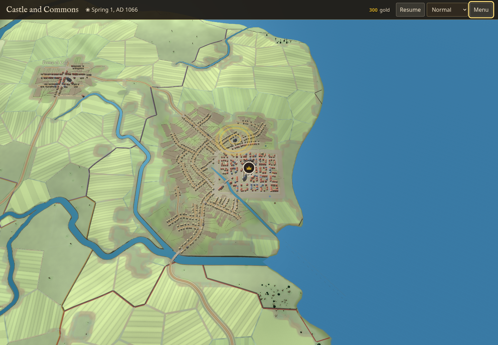

After calling out the watch, a crown badge appears above Rougecastel. It means
**The Watch of Rougecastel**, rather than the town or the monarch. Hover resolves
`type: army` and changes the canvas cursor to a pointer, but displays no name,
strength, order or explanation. The normal Menu has no Map legend entry.
This confirms the discoverability problem in #93. The yellow circles elsewhere
in the capture are event pulses; they have a different meaning from the badge.

Clicking the badge sets the inspector target to the army but opens no card,
even after the worker query finishes. A query for the same target, `a1`, returns
`Error: innerWidth is not defined`. Source: `armyActsHTML` calls `uiLayout`, which
reads `innerWidth` and `matchMedia` inside the worker. `workerQuery` catches the
failure, logs it to the console, and returns null. This is #91, a functional
blocker for the normal host → Orders → march flow, not just an unfamiliar icon.

Use named hover/tap explanations and a marker key. Keep browser-dependent copy
out of worker card generation, and give a visible recoverable error when a card
cannot load. Project pegs/bands also need actual project pick records:
`refreshOrders` currently creates geometry without them. The specific additional
ground symbols the user saw were not supplied, so this does not identify every
possible symbol in a later save.

## 2. Open Crown → Learning — broken

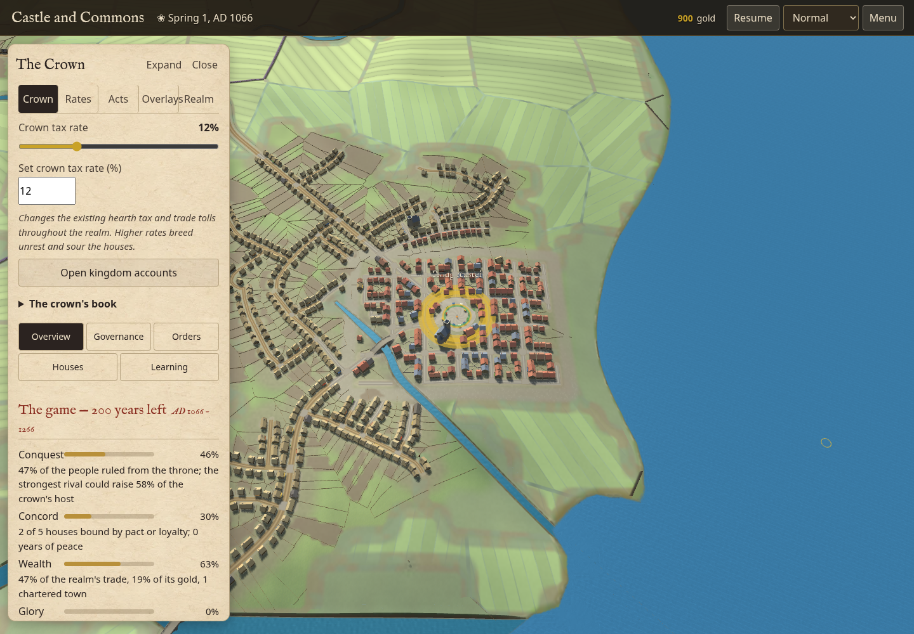

Menu → Crown works. Clicking Learning produces an Overview card instead.
After the query settles, renderer `crownSection` is `learning`, but the returned
HTML has Overview selected and its campaign summary visible. The actual learning
controls are inaccessible through that tab (#90).

`workerRefreshCourt` passes the section correctly. `workerUIQuery` accepts only
`overview`, `governance`, `orders`, and `houses`, so it ignores Learning. Use one
complete section contract shared by the controls and worker. Verify selected tab,
visible panel, mouse activation and keyboard navigation together.

The compact card also makes navigation harder: realm tabs crowd Overlays against
Realm, and tax controls sit above every court view. In the Orders view, the first
action begins more than halfway down a 1000 px screen. Treat those as layout and
hierarchy improvements alongside the actual tab failure, not evidence that every
menu route is broken.

## 3. Issue Build a mill twice — loses coin

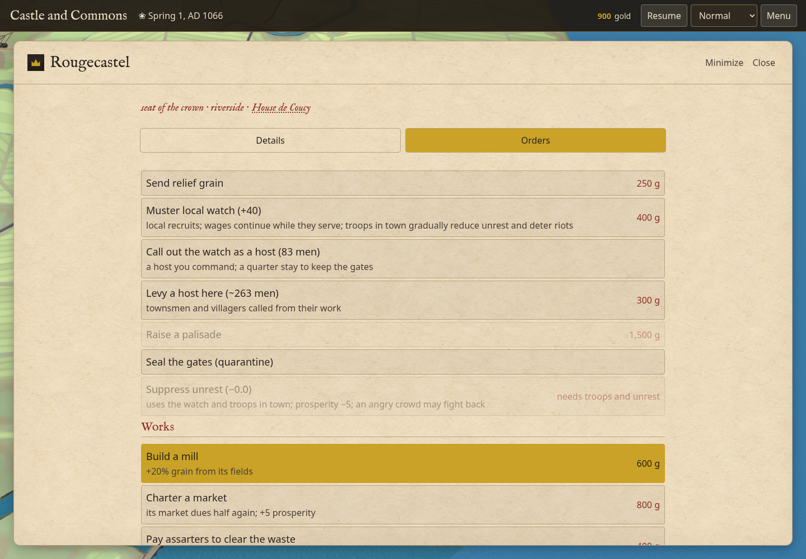

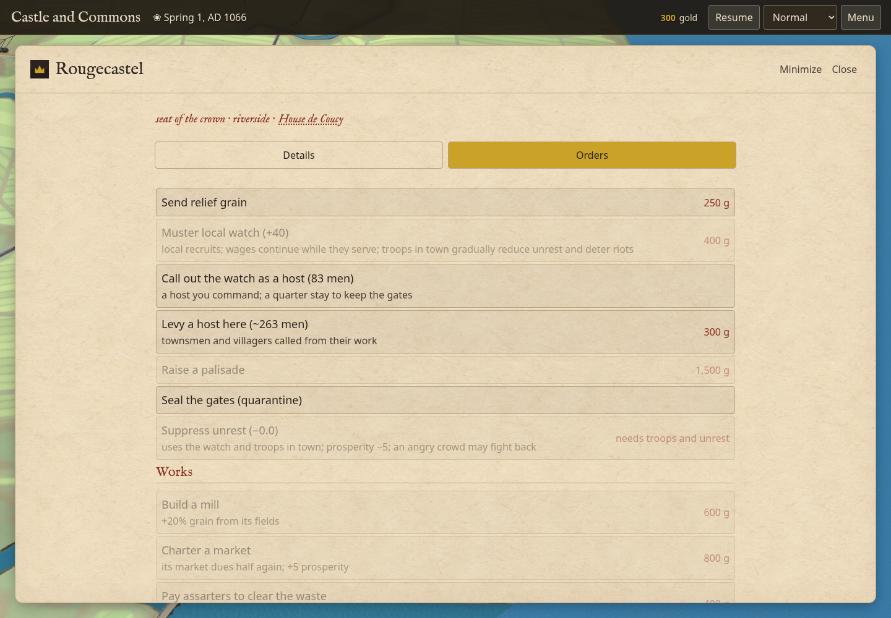

From the town's Orders sheet, the first Build a mill click takes the treasury
from 1,500 to 900 gold. Its annal says “The crown builds a mill at Rougecastel.”
The button remains enabled with its original 600 g price. A second click takes
another 600, leaving 300; the button becomes disabled because the purse is now
too small, rather than displaying “built” (#89). Both actions occurred on day zero.

`settlementWork` stores `s.works[k]=day()`. Its duplicate guard and `worksHTML`
use truthiness, so a completion at day zero is indistinguishable from absence.
Market-toll and advisor readers also use truthy work flags. A completed work needs an
explicit existence check that preserves its recorded completion day. This is a
model bug with payment consequences, so a future repair needs duplicate-order,
actual-payment, production and save-continuation verification.

Rougecastel already had a physical river mill before the order. The Works
control is also a legacy economic improvement flag, not a surveyed building
commission; the label does not explain that distinction. Its broader paid-work
contract is already tracked under #80. The audit does not claim two new physical
mill buildings were constructed.

## 4. Call out the watch and read the result — unclear

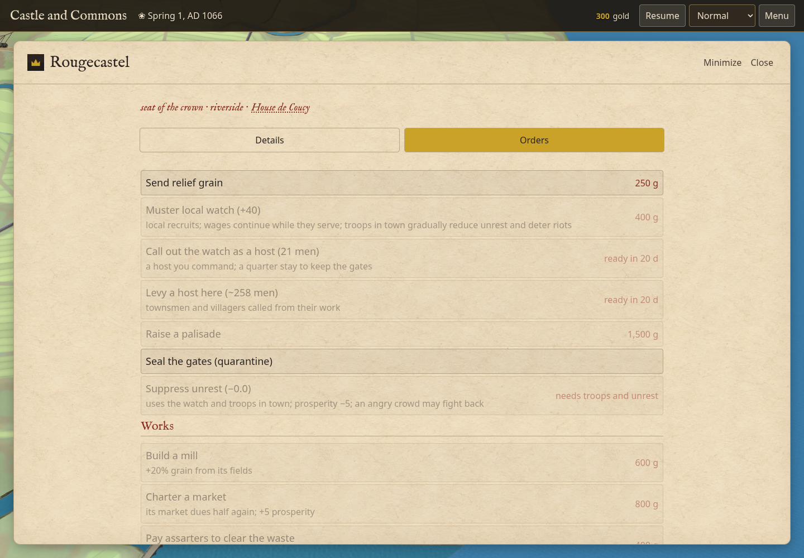

The action successfully creates **The Watch of Rougecastel**, with 83 men.
The town retains 21, and the callout/levy buttons show a 20-day cooldown. Those
are real consequences, but the sheet offers no acknowledgement explaining them
or link to the resulting host (#92).

The worker records the correct annal. Immediately after its response,
`eventBubbleUpdate` leaves the bubble hidden because the expanded Orders sheet
is the active modal. The Annals are closed, the map is covered, and
`workerSubmitNow` refreshes the controls without presenting the command reply.
Prices, costs and many refusal reasons before clicking are a useful existing
strength; they need a matching result after clicking.

Put pending, accepted and refused results beside the initiating action. Include
what changed, actual coin paid, what happens next and a link to the affected
object. A result should remain available while the player reads or corrects it.

## 5. Pave a road, click an invalid target — recovery is awkward

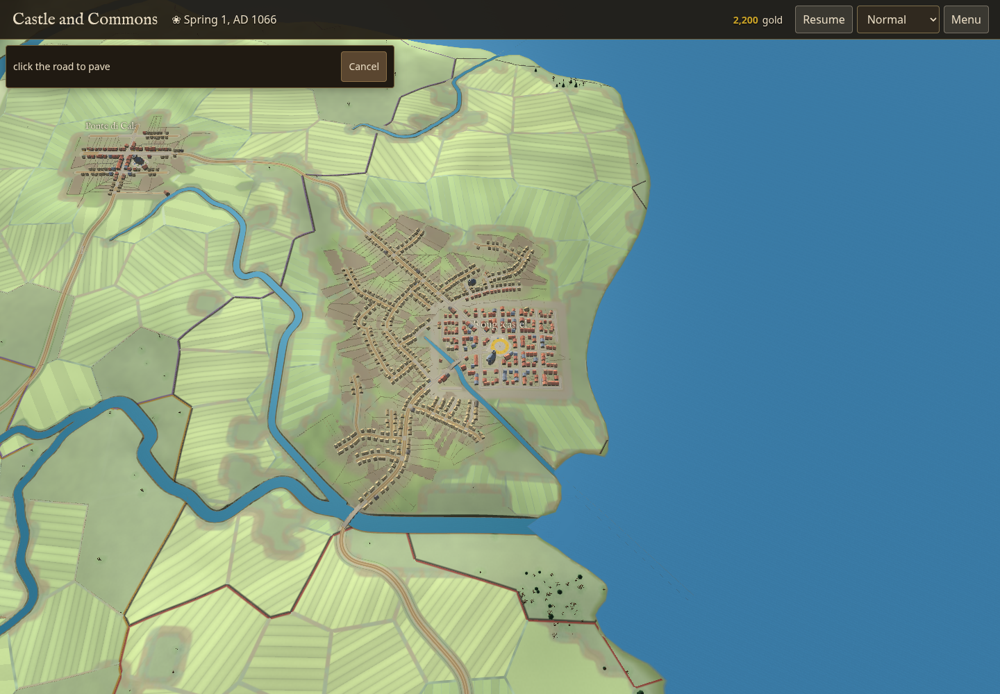

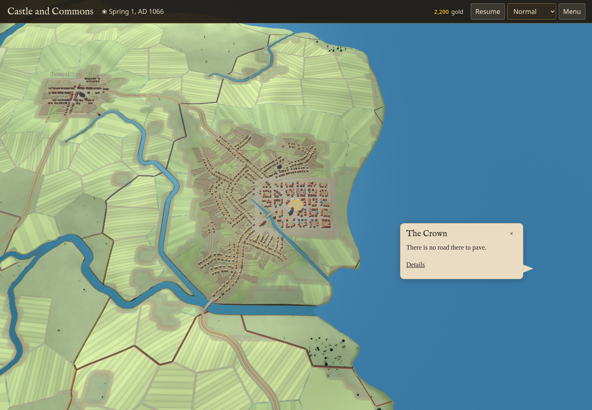

The placement prompt correctly says “click the road to pave” and offers Cancel.
An invalid click produces “There is no road there to pave.” A fresh unobscured
DOM check confirmed that the nearby error bubble is visible; errors are not
universally absent. However, the placement prompt disappears immediately and
the player must reopen Crown → Orders → Pave to try again (#92).

`onClick` calls `setPlaceMode(null)` before validation. Keep invalid placement
active with a reason and a clear correction, and complete it only on acceptance
or explicit cancellation. The valid error screenshot is included below with
the placement state. One resized capture with a black, undrawn canvas was
rejected as harness evidence; it is not a game defect.

## 6. Expand an active planning brush — map interaction blocked

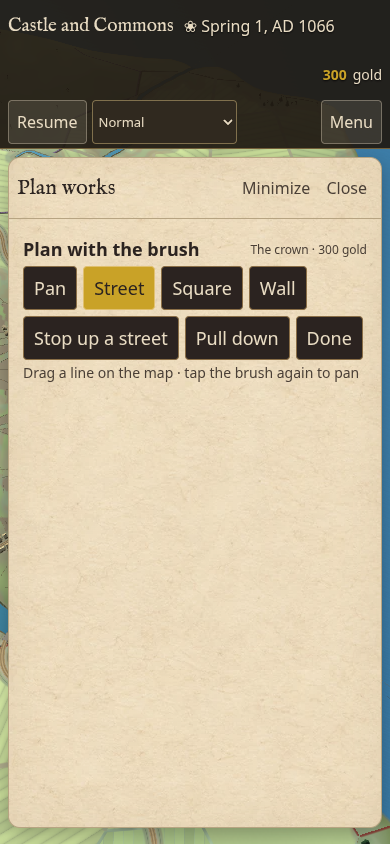

At 390×844, Menu → Plan → Street → Expand shows “Drag a line on the map · tap
the brush again to pan.” The sheet covers almost all of the map and the modal
handler sets `#gl.inert=true`. The requested task cannot be performed in that
state (#94).

Escape/Minimize returns to the compact brush, restores map interaction and
retains Street; a second Escape closes planning and returns focus to Menu.
Those recovery controls work. Keep active map tools compact, or make expansion
a separate review step with instructions to return to drawing.

## Accessibility and evidence limits

Main menu controls and primary tabs have large targets; the tested menu fits
inside the 390×844 viewport. Tab roles, selected states, visible keyboard focus,
Escape recovery and restored focus are useful foundations. They do not overcome
the broken Learning route or host card query.

The host badge is drawn in canvas, has no named hover explanation, and cannot
be reached as a DOM control. The Crown's host list could provide another route,
but its card uses the same failing worker query. The command bubble has no
`aria-live` or status role, and the expanded sheet has no result status. The
separate event-details text is polite live content but empty in the observed
result state. Screen-reader announcement and complete keyboard access still
need assistive-technology testing. Faded disabled text has a visible contrast
risk; contrast ratios were not measured.

This is a bounded interaction audit, not full WCAG certification, a performance
benchmark, a Safari/touch-device test, a late-world soak or a simulation-purity
proof. Paused commands and fresh openings were examined; loaded old saves and
all speeds were not. No game code was changed, fixed or deployed during the audit itself.
The audit prioritized the three functional blockers, followed by durable
order feedback, marker explanations and operable planning layout.

## Repair evidence

The subsequent repair exercised the same real worker and native commands in a
fresh paused AD1066 realm. Fifteen browser checks passed: Learning mouse/rapid
keyboard selection, Govern town → Orders, one paid mill and duplicate refusal,
call-out result → host card → native march, host hover, the Map symbols key,
invalid pavement retry and Escape, accepted pavement → project card, actual
paving-band hover/click, and a street drag in the 390×844 planning layout.
No browser page errors were recorded. A further browser check confirmed that
the paving result and project card quote the same commissioned wage/material
estimate, while the purse correctly reports no advance payment.

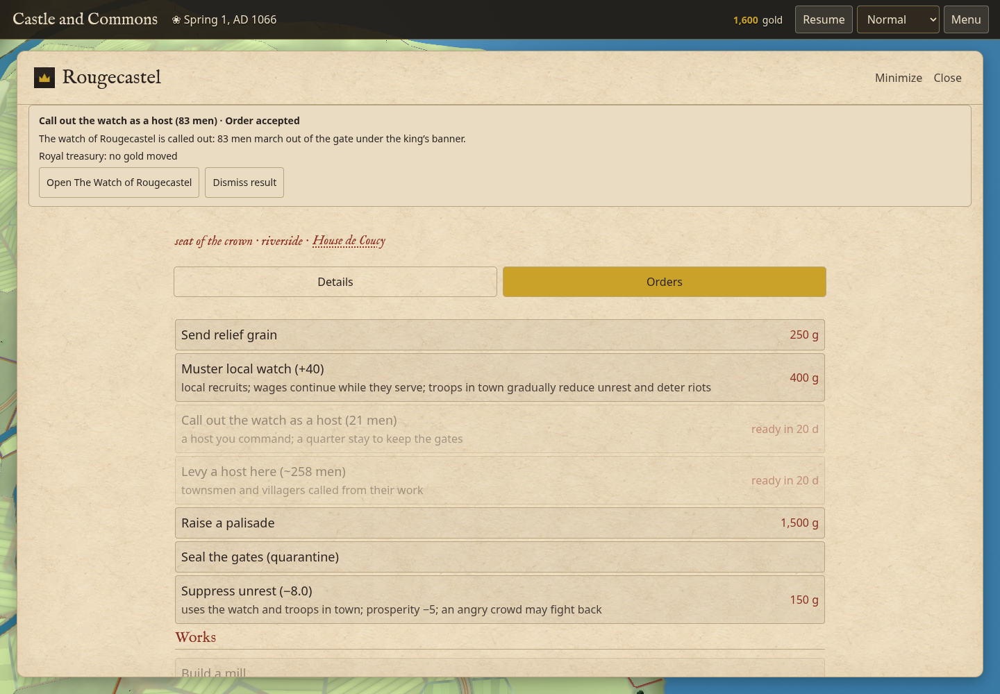

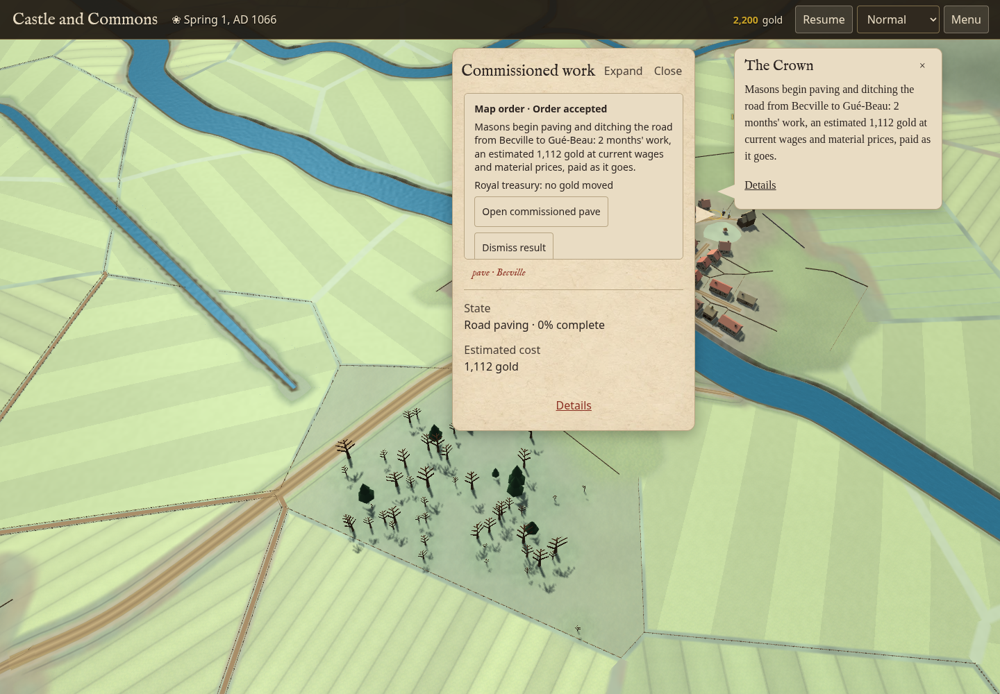

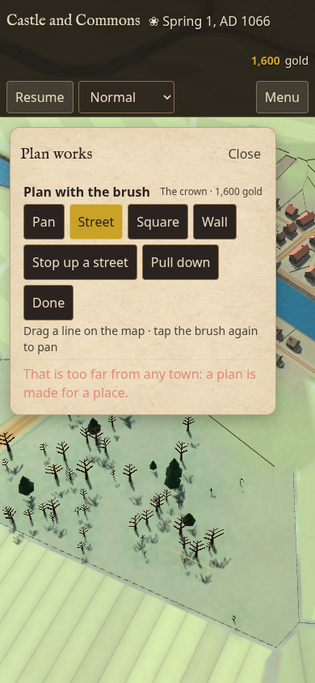

Fourteen regression cases in `tools/playability-orders.test.mjs` cover actual
Crown/lord mill and market builder payments at day zero, conserved coins and
serialized completion flags; worker Learning and stale court replies; host
controls without browser globals; asynchronous Govern town; read-only command
receipts; refused/accepted/two-end/cancelled placement; storage working-day
progress and retired projects; compact planning; sky-click recovery; and the
actual pavement estimate without an advance charge.

Native paid mill/market verification transferred 1,400 gold to actual recipients,
rejected both duplicates without changing money or RNG, retained day-zero
completion through a world save/load, and continued both played and loaded
realms for five closed days with matching RNG and clean cash/inventory/fault
checks. The loaded realm deliberately received extra rejected commands, so this
case does not claim identical command journals or full saved bodies.

These changes intentionally repair opening-day work completion and the paving
announcement. They add no nominal-speed simulation clock or per-frame model
work. Screenshots use controlled render frames and establish interaction and
layout, not animation performance. Machine-readable receipts and full native
checkpoints are retained outside the repository in
`/workspace/furlong-playability-fix/`; current release status remains in #89–94.

The final pre-stamp HTML SHA256 is
`3c73a6eac8327ad13a5136570003f4fd34180f3cd9aeb616cbc8718048e6b2e8`.
At sea seed 1001/fate 42/AD850, complete world-save bodies at days 0/50/100/150,
private counters, all RNG streams and all 1,812 journal rows match release
`b741919`. Final verification used 71.09 CPU seconds with load average
0.24/1.27/2.48 at start and 0.81/1.24/2.40 at finish. The earlier multi-world
candidate also matches inland seed 2002/fate 42/AD1066 through day 30, including
464 journal rows; its only later changes were renderer navigation/recovery and
the accepted paving announcement. Both scenarios have clean inventory/cash
checks and zero simulation faults. This establishes the tested histories, not
long-term economic balance or every late-world UI read.

The regression batch completed all 2,245 checks: 2,243 passed initially, and the
two failures were isolated VM fixtures missing the real `projectMarkerKey`
helper and foreground `BACKGROUND=null` configuration. Their assertions were
unchanged; the selected projection check and all ten patron-gift checks passed
on recheck. All 59 focused order/context/worker/advisor/source checks passed
on the final source. Native save continuations include the paid first castle
and AD1200 royal eyre; all three 120-day native street-footprint worlds pass.
The batch used 3,698.36 CPU seconds with load average 1.16/1.23/0.95 at start
and 1.17/1.75/2.76 at finish; it is validation workload, not a game-speed measure.

After the batch, the only game change removed the sampled camp-member count
from its hover label; camp inspection still queries the actual membership.
The focused source checks, a label smoke check and the final 150-day identity
proof cover that last caption change. Machine-readable receipts preserve the
batch and final source hashes, fixture failures/rechecks and the one-line delta.

The repair was released as [13447ff](https://github.com/healdgar/furlong-kingdom-annals/commit/13447ff55dfa6387f19a7bedad706c2a3380652c).
Pages/container workflow [127](https://github.com/healdgar/furlong-kingdom-annals/actions/runs/38305044317) succeeded; both linux/amd64 and
linux/arm64 payloads match all nine HTML/asset/license files. The stamped HTML
SHA256 is `af6e4ed426c403f42f80938535add793f3bebd8fd030c8902b9cb0361a7bd49c`;
image index at publication is `sha256:f42df8024e4063a99b93dc8015675b38429992a54a48b1bb3f874b97d56d859c`.
The live Pages hostname and claude.ai artifact limitations are retained in #84.
