# Further UI and playability scan — 12 October 2026

The fresh worker-game scan reproduced eight additional navigation, date and interaction
problems (#95–101 and #103). They affect ordinary play: account figures change scope,
older replies replace newer views, Find fails on named cards, keyboard links
activate the wrong thing, card drill-downs have no Back, family choices lack
identity, order results intercept phone menus, and pre-opening birthdays show undefined
seasons and negative days. Current work and publication
status remain solely in [ISSUES.md](ISSUES.md).

The initial screenshots were captured from released HTML
`af6e4ed426c403f42f80938535add793f3bebd8fd030c8902b9cb0361a7bd49c`.
The game is an isolated fresh native worker world: seed 1001, fate 42, sea,
AD1066, default 9 km. Desktop is 1440×1000; phone is 390×844.
Screenshots below were captured and inspected for this scan. They are real game
screens, not mockups; none comes from the earlier playability audit.

## Flows and general health

| Step | Important flow | Observed health and repair |
|---|---|---|
| 1 | Fresh paused realm → Menu → Crown/realm/account entry | Entry and root-panel controls operate; opening a new root or closing a card clears its old trail. |
| 2 | Town card → town accounts → Refresh balances → Back | Repaired #95/#99. Town refresh retains native scope and scroll; Back restores the compact town card. Kingdom and town requests have distinct identities. |
| 3 | Open accounts → choose Crown or Close before delivery | Repaired #96. Pending state is visible; actual held worker replies cannot replace the newer panel or reopen a closed one. Busy state clears on departure. |
| 4 | Timeline → monarch → Find → spouse → Back | Repaired #97/#99. Find reads the worker's position/type metadata; Back restores the full monarch card, scroll and camera. Routes resolve current records rather than caching old cards. |
| 5 | Monarch → family tree → person links | Healthy in the sampled tree: named people remain linked and open their cards. |
| 6 | Person → known family; shared surname → choices | Repaired #100. The known family uses its actual ID and worker-provided heading. Shared names add age, trade, place and member-count context. The census retains actual soldiers, travellers and people promoted into the annals; genuinely empty records are explained rather than offered as dead ends. |
| 7 | Expanded court tabs by keyboard; call-out host → compact town link by Enter; host Follow | Repaired #98/#97. Arrows/End retain the selected tab and focus. Enter follows the nested town anchor; host Follow uses the actual live projected host. Native call-out and its persistent result continue working. |
| 8 | Phone order result → Menu → Help → Close | Repaired #101. Menu buttons receive clicks above the floating result. Help opens its real modal, and closing it retains the order result. |
| 9 | Soldier card → pre-opening birthday and life dates | Repaired #103. Earlier-year offsets display valid seasons and days; missing dates are stated as unrecorded. The simulation formatter and stored dates are unchanged. |
| 10 | Roman town card → History at a 1066 opening | Unhealthy origin chronology (#102). The native capital story implies a Roman founding in AD736. It remains a separately tracked generation issue. |

## Accounts and late replies

The town ledger originally contained 18,484.62 gold. Refresh replaced it with
58,096.4 gold and Royal treasury under the unchanged town heading. The adapter
now freezes and reuses the requested town, reference and view. View replies also
check whether navigation still owns the destination. This changes delivery of UI
results; it does not change worker ticks or simulation scheduling.

Before, Refresh shows kingdom balances under the town heading:

After, the refreshed town ledger retains its native 18,484.62 total and offers Back:

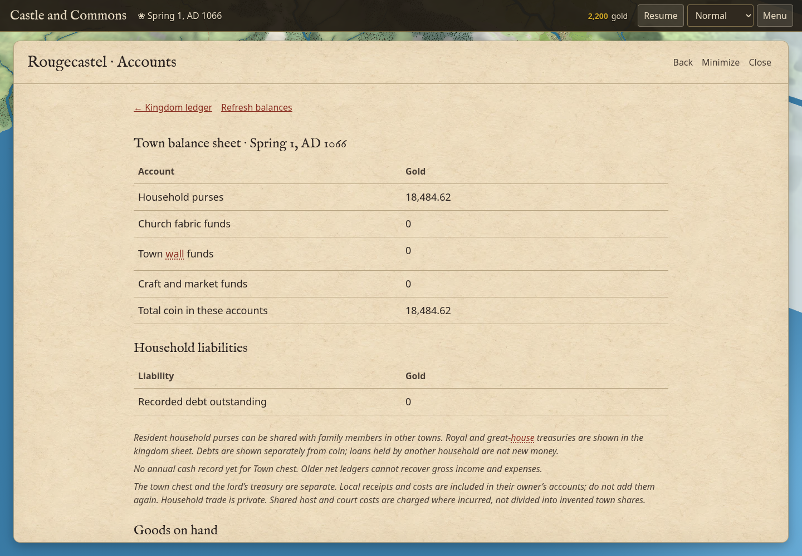

A separately reproduced late native ledger reply originally replaced Crown:

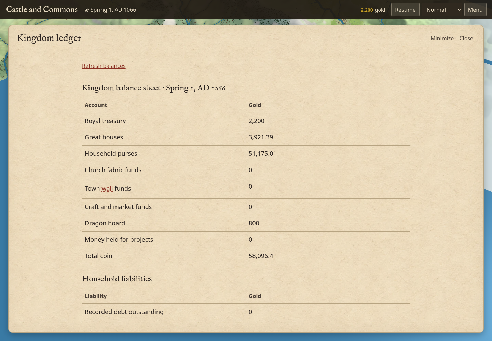

The reply-order checks delay delivery of real worker responses. They do not
fabricate view data or alter model state. Current errors appear inside the view;
errors belonging to an abandoned request are ignored.

## Linked cards, Find and keyboard control

Named cards use a renderer reference pick, which formerly bypassed camera dispatch
for its actual person/town/actor. Camera actions now use worker metadata, including
live actor identity for host/caravan/dragon Follow and the exact home destination
for a deceased person's Show home. A notable without a current location has no
pointless Find control. The route trail is renderer-only, bounded to 24 views and
excluded from the world save. The advisor discovers the same available Back
control, and does not advertise expansion while the player draws a plan.

Before, the named monarch's Find did nothing:

Before, following the spouse link offered only Minimize and Close:

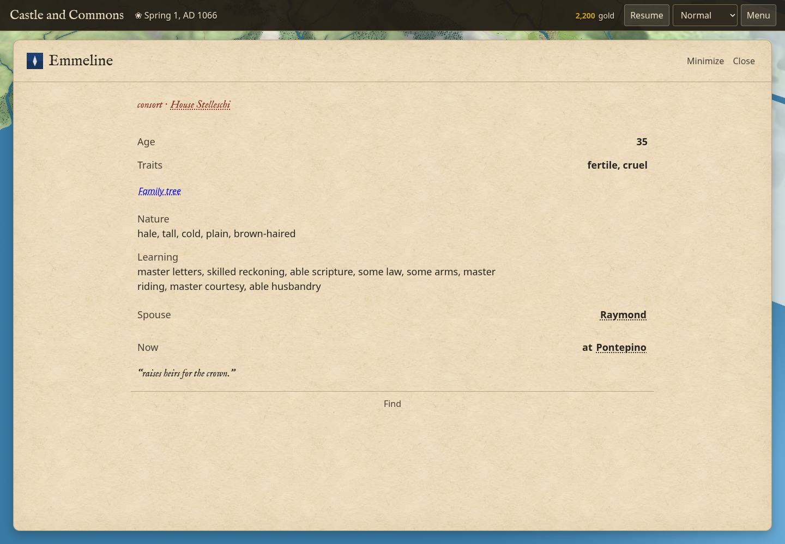

After, Back returns from the spouse to the original full card:

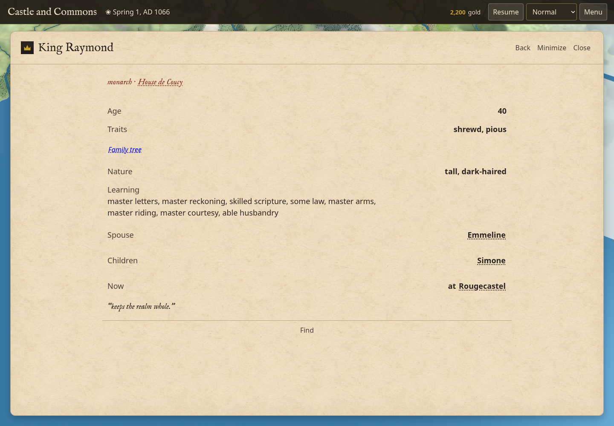

Before, expanded Learning ignored arrow keys:

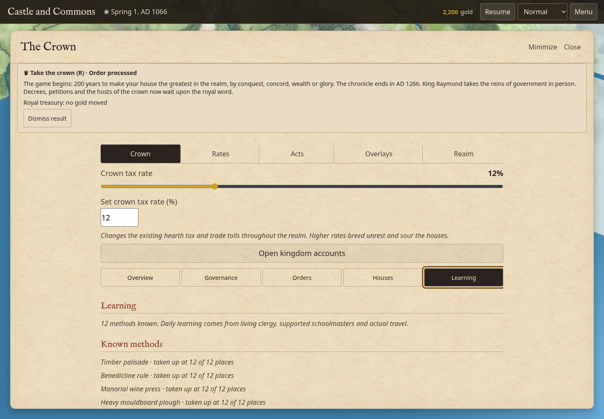

After, expanded tabs support arrows and End, including focus:

Before, Enter on the compact host's town link expanded its parent card instead:

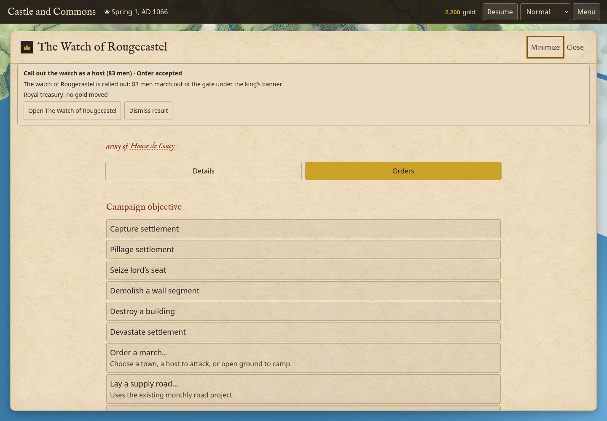

The keyboard handler now lets native anchors/buttons activate themselves while
handling custom controls and tab navigation inside expanded dialogs. Escape and
Tab trapping retain their existing behavior.

## Family identity and phone menus

Before, a known person's family became 28 visually identical choices:

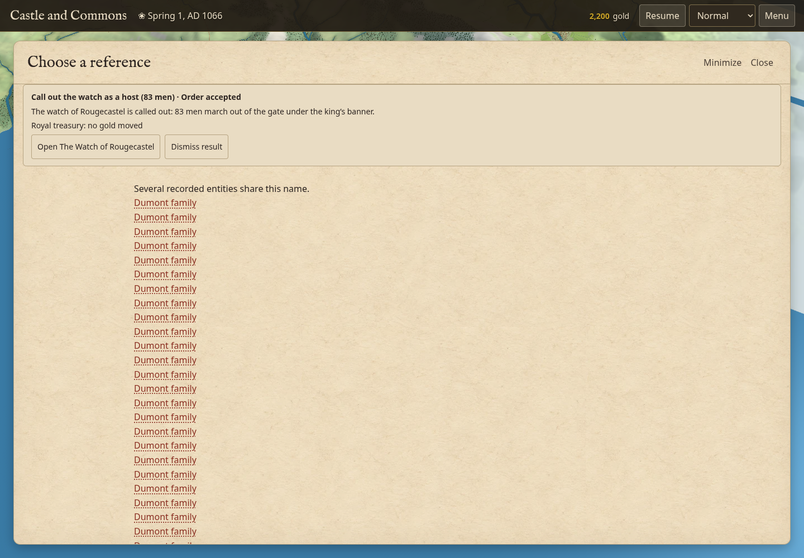

The chooser takes one people census for all its family options, rather than
scanning the whole realm once per option. Families without any named recorded
member are counted in an explanation; there is no empty destination to choose.

After, the person's Family link directly opens the actual family and recorded people:

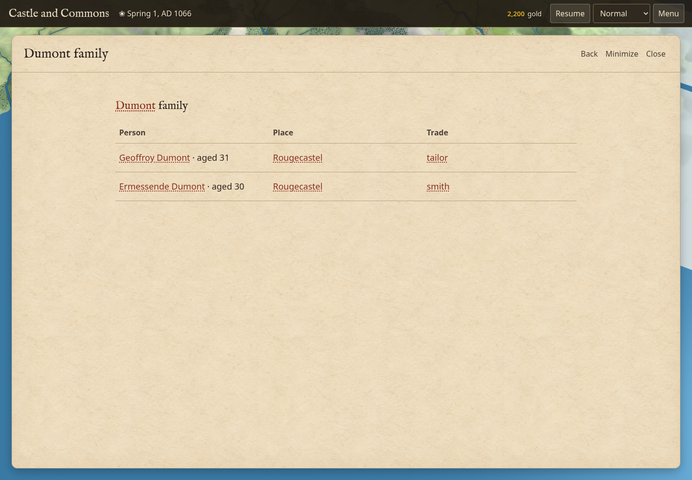

The final chooser gives all 28 families meaningful age, trade and member context:

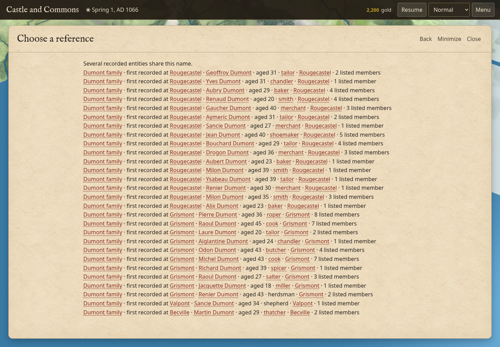

Call-out initially made two families appear empty because their people had left
the town list for the actual army roll. The census now includes those rolls,
active travellers and people promoted into the annals, without double-counting.
Explicit person links resolve current army members for inspection and Follow;
the simulation's person finder is unchanged.

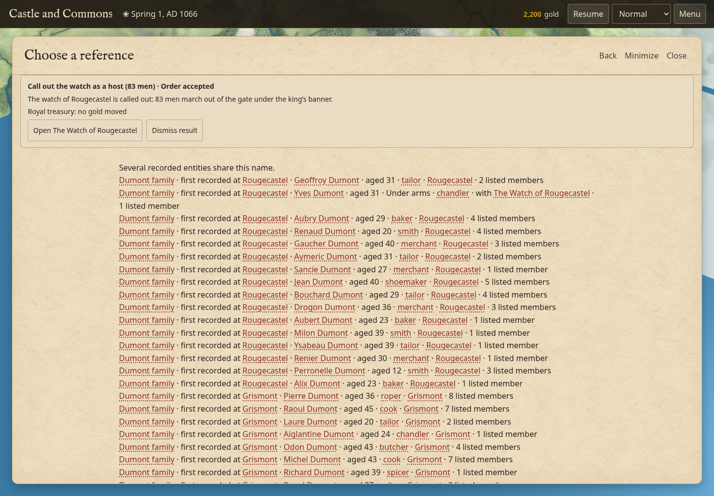

The real enlisted person’s [card and host Follow](screenshots/ui-scan-2026-10-12/after-soldier-family-link.png) remain available.

Before, the result covered the phone's lower Menu controls and intercepted Help:

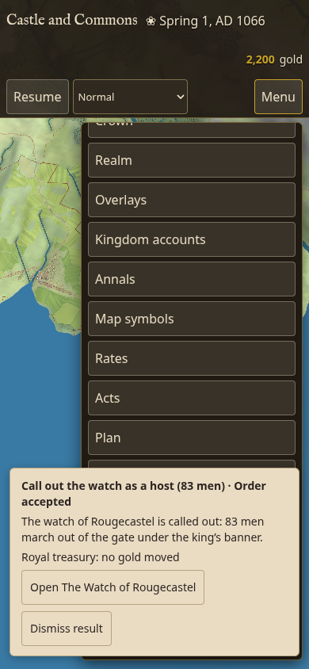

After, the menu is above the retained result:

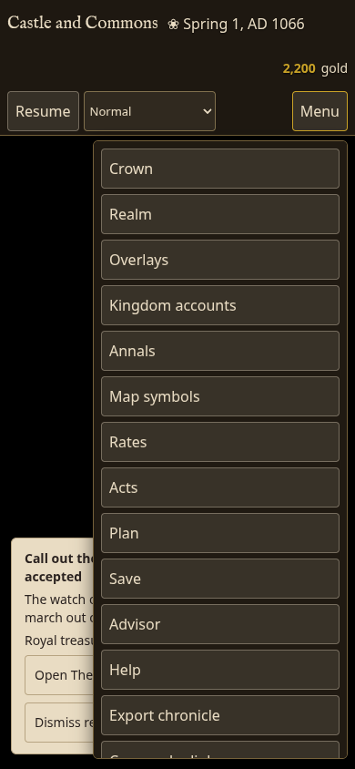

An actual Help click opens the modal:

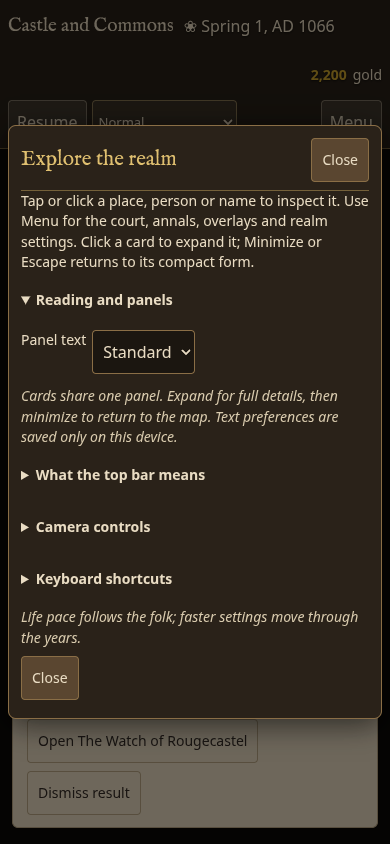

## Pre-opening birth and life dates

A real enlisted Yves Dumont card originally displayed “Born undefined -6,
AD1034”. The simulation's date formatter uses JavaScript negative remainders.
Card display now converts earlier offsets to a positive day within the earlier
year; current/future dates retain the original formatting and stored birth/event
dates are unchanged.

The invalid date was observed in the earlier native soldier capture during this
scan; its PNG path was subsequently overwritten by the corrected capture. That
image is not presented as retained before evidence.

The same native birthday now reads **Born Winter 84, AD1034**.

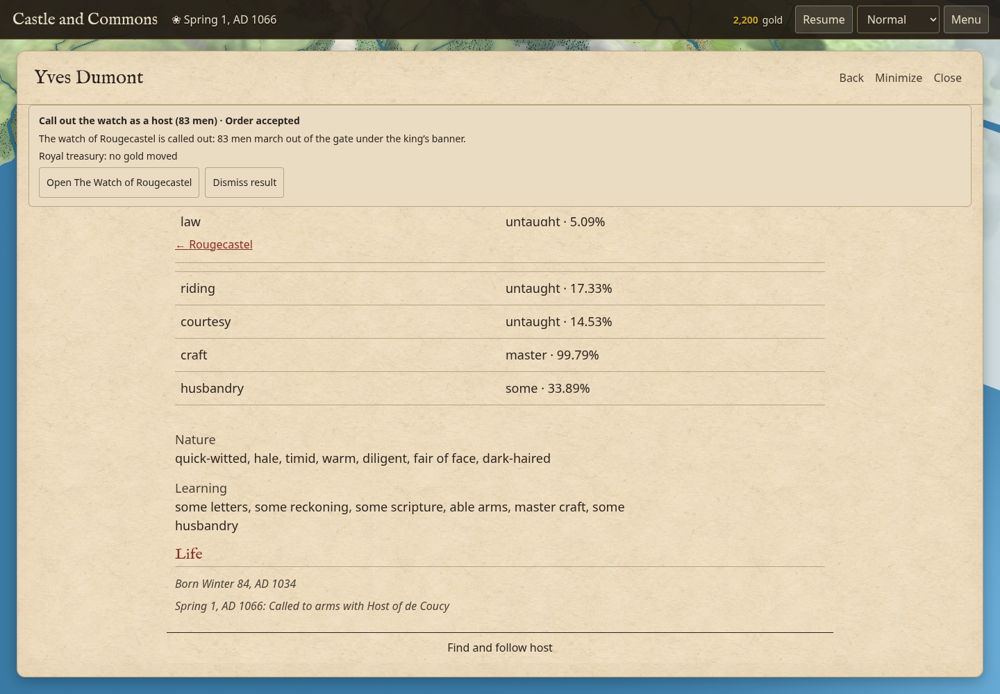

## Town grids in AD1066

The follow-up question exposed a separate generation assumption, tracked as
#102. At AD1000 the layout branch changes from early grown towns to role-based
templates: border towns receive Roman grids, capitals draw a 30% Roman chance,
and market towns draw a 55% planned chance using a Freiburg-inspired layout.
The corresponding rectangular walls and synthetic Roman founding story are
generated together. The generic five/six layout epochs place that founding
280/330 years before the annals—AD786/736 at this opening—contradicting the
asserted ancient origin. The expanded town card exposes the story under History. Inherited Roman and earlier medieval planned streets can
exist in 1066, but role alone does not establish that origin, and this broad
switch does not date the particular planned foundation. Rougecastel’s actual worker card confirms the 330-year founding story:

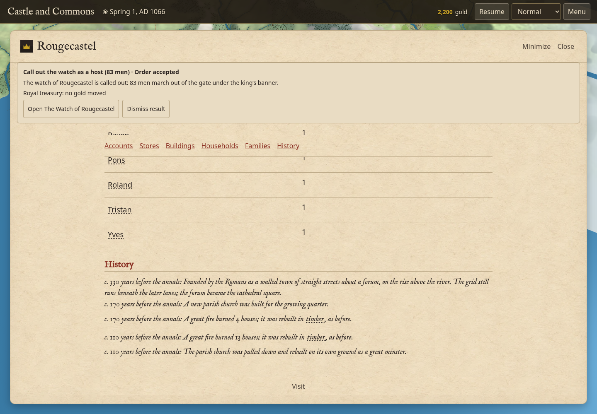

These layouts need
origin/culture/chronology assessment; the UI batch preserves generated history.

## Validation and limits

- Full batch: **2,232 passes / 3 failures**, with zero skips or cancellations.
  Two fixtures lacked the current DOM method/source seam; the search gate caught
  an unreviewed per-option world census. The fixtures were corrected without
  weakening assertions, and the chooser now uses one census without enlarging
  the search inventory. All **116 affected checks** and **35 final control/source
  checks** pass. Including the 28-case navigation/calendar file and restored
  worker-boundary module, **2,273 distinct checks** are verified across runs.
  This is not a single 2,273-pass full batch. All three native 120-day street
  footprint worlds and the native save/continued-world cases passed.
- Browser: **15 initial flow checks**, then **8 checks on the final source**,
  including 28 distinct family choices before/after real call-out, an actual
  soldier link/host Follow, UI/advisor Back, a valid negative-offset birthday and
  the native Roman founding story. Page-script errors: zero.
- Final source HTML SHA256 before stamp: `9c45ef4731e534f3936471b381dd56f6927fb6bf5ce1017c1e302012bfc88938`. The final
  browser and native gate both identify these exact bytes. A guidance-only
  intermediate HTML delta was checked to leave the main game script unchanged.
- Final native identity: **150 days, 1001:42 sea/AD850**, plus a **30-day
  2002:42 inland/AD1066** conservation window. Complete saved-world bodies at
  every checkpoint, private counters, all RNG streams and **2,276 raw outcomes**
  match the previous release; cash residuals are below 1e-7, goods audits are
  clean and faults are zero. These are short windows, not century/economic
  calibration or proof that every existing UI inspection is pure (#27).
- CPU: final native gate **144.10 s**, load
  **0.16/0.49/0.80 → 1.24/0.80/0.88**. Full batch **3,379.27 s CPU**, load
  **1.19/0.90/0.56 → 1.11/1.95/2.68**. Heavy jobs ran serially, with one
  Chromium instance at a time.
- Detailed local run receipts: `/workspace/furlong-ui-scan/`. Publication
  evidence and current limits belong in #84 and the current issue rows.

This is a bounded flow audit, not a full WCAG conformance claim. Chromium used
software WebGL, the worker was paused, and continuous animation was suppressed;
explicit frames were used for captures. DOM flow screenshots do not certify
camera animation, resized-canvas rendering, graphics throughput or speed changes.
One initial browser attempt caught a lingering busy flag, then the corrected
source passed. Harness corrections addressed selector ambiguity, waiting for the
native panel HTML, showing the full Follow control and resolving surnames in the
worker where private families live; these are not additional game bugs.

Safari, physical touch input, screen readers, every late-world entity and all
possible reference combinations were not exercised. The sampled opening-day
person had no native home record, so absence of a Home link was not counted as
an omitted existing property; systemic homestead work remains #61. Other existing
simulation, inspection-purity and advisor gaps remain in ISSUES.md.
